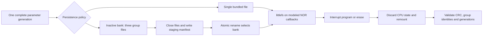

# Flight Config Transaction Lab

**Crash-consistent configuration snapshots for embedded flight software, tested
against real littlefs C code.**

This C99 lab asks a practical question: when several parameter groups must agree
after a reset, what storage work is required to preserve one complete generation?
It compares an atomic single-file bundle with a two-bank, manifest-selected
multi-file layout. Sequential per-file updates are a negative control.

The implemented algorithms are established persistence patterns. The deliverable
is a reproducible comparison, a reusable C prototype and inspectable fault traces.

## Observed result

- **11,002 execution records:** 10,963 modeled interruptions plus 39 acknowledged-save
  controls. The campaigns overlap; this is not 11,002 independent failure modes.
- **Bundle and manifest:** a complete old or new snapshot in every observed cut;
  all retry-after-reset checks passed.
- **Sequential files:** 2,298 mixed-generation storage states, all rejected by the
  loader. This illustrates the missing group transaction; it is not a littlefs bug.
- **Cortex-M4:** the same C layer and littlefs executed 36 nominal save/reset/load
  cycles in Unicorn. No target power-cut campaign or physical board test is claimed.

For one matched 128-byte-per-group trace on a 32 KiB modeled medium:

| Policy | Programmed bytes | Erase calls | Snapshot property in the observed cuts |
|---|---:|---:|---|
| Sequential files | 576 | 3 | Mixed groups can remain; loader rejects them |
| Atomic bundle | **448** | **1** | Complete old or new |
| Manifest / two banks | 1,136 | 5 | Complete old or new |

**Prefer the bundle when one file is acceptable.** The manifest preserves separate
group files at a measured extra I/O cost in this trace. It is not presented as a
faster or more durable algorithm. [Raw results and full report](results/recorded/REPORT.md)
include all profiles and the exact assumptions behind these numbers.

## Quick start

Requirements: Python 3.12 and a C99 compiler. No Python packages are needed for the
host campaign. On Windows, if GCC/Clang is absent, the runner downloads the pinned
public Zig 0.14.1 compiler into ignored `.tools/`, checks its SHA-256 and uses its
C driver. Nothing is installed system-wide. Subsequent runs can be offline.

```sh
python tools/run_tests.py
python tools/analyze.py
python tools/replay_case.py
```

The last command reproduces one recorded mixed-generation case in the real C
implementation. Every invocation writes fresh results under ignored `runs/`;
checked-in evidence is never an output target. Supply `--cc` for a particular
GCC/Clang executable. `--quick` skips only the complete-prefix follow-up.
An existing Zig installation can be selected with `--zig path/to/zig.exe`.
`python tools/verify.py` checks the shipped source hashes and recorded CSVs
without compiling code, installing tools or changing evidence.

For a conventional GCC/Clang CMake environment:

```sh
cmake -S . -B build -DCMAKE_BUILD_TYPE=Debug
cmake --build build
ctest --test-dir build --output-on-failure
```

[Windows CMake with Zig](docs/BUILDING.md) is also documented and tested locally.
The GitHub Actions workflow is included; no remote CI run has been performed here.

## Optional ARM execution

Install the freely available Arm GNU Toolchain and put `arm-none-eabi-gcc` on PATH
(or set `ARM_GCC`). Then:

```powershell
python -m venv .venv
.venv/Scripts/python -m pip install -r requirements-arm.txt
.venv/Scripts/python tools/run_arm.py
```

This executes compiled Cortex-M4 instructions and littlefs with a RAM-backed
modeled medium. It does not emulate a physical flash peripheral, flash timing,
brownout voltage or radiation. The fixture links without dynamic allocator symbols.
[Recorded ARM output](results/arm/arm.json) separates library contexts, full fixture
sections and the synthetic medium; no peak-stack or silicon-footprint claim is made.

## Design



The serialized format is explicitly little-endian; it never writes a compiler's
struct layout to storage. CRC32 checks accidental corruption. The C layer has
fixed buffers and no allocator. It permits one caller at a time and expects a
mounted littlefs volume with a 64-byte cache.

| Path | Purpose |
|---|---|
| `include/`, `src/` | Portable record format and transaction prototype |
| `tests/ram_nor.*` | Modeled 1-to-0 programming, erase and abrupt interruption |
| `tests/campaign.c` | Deterministic cuts, recovery oracle and retry checks |
| `tests/unit.c` | CRC, bounds, malformed records, generation wrap, cache validation |
| `tools/` | Build, execute, independently analyze and replay evidence |
| `third_party/littlefs/` | Unchanged pinned BSD-3-Clause dependency |
| `results/` | Actual host/ARM outputs, commands and hashes |
| `docs/` | Contract, source review, porting and remaining limitations |

## Spacecraft relevance and scope

F Prime's [parameter database design](https://github.com/nasa/fprime/blob/devel/Svc/PrmDb/docs/sdd.md)
documents persistent parameters loaded at startup and saved to a file. That
establishes the spacecraft-software function. This project uses synthetic records
and an independent format; it does not integrate with F Prime or demonstrate a
defect in PrmDb. F Prime's existing whole-table file design is relevant competent
prior work, not something this project claims to invent.

littlefs already documents [atomic file operations and power-loss recovery](https://github.com/littlefs-project/littlefs).
This lab evaluates the application-level group boundary above those guarantees.
See [sources and related work](docs/SOURCES.md), [fault model](docs/EXPERIMENT.md)
and [skeptical assessment](docs/REVIEW.md).

This is a tested engineering prototype suitable for sharing, not flight-qualified
software, a demonstrated new algorithm or a completed IAC research contribution.
Physical power cuts, asynchronous flash/controller behavior, device wear, bad
blocks, out-of-space behavior and schema migration remain outside the campaign.
The repository was prepared with AI assistance; local execution records are provided.

[Validation record](VALIDATION.md) lists executed checks, tool identities and the
exact boundary between host fault campaigns and nominal ARM emulation.

## License

Authored code: MIT. Vendored littlefs: BSD-3-Clause, with its original license.
See [third-party notices](THIRD_PARTY_NOTICES.md). [Repository name, description
and upload notes](GITHUB.md) are included; this task has not published anything.
"# flight-config-transaction-lab" 
